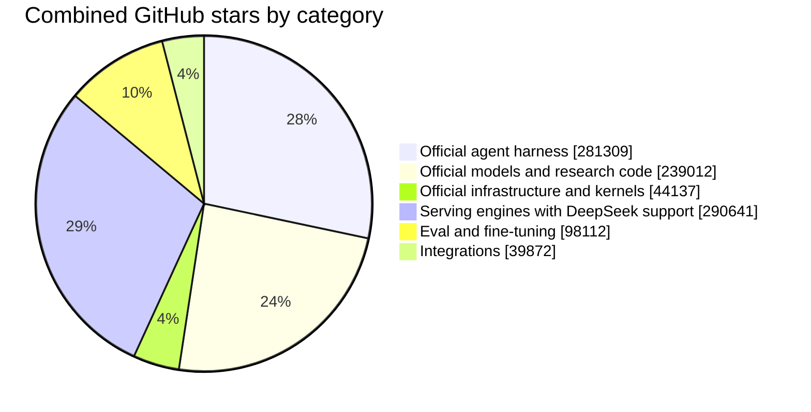

# Awesome Craft DeepSeek 

> A curated list of official DeepSeek repositories and open-source harnesses, serving engines, eval tools and fine-tuning stacks that work with DeepSeek models.

DeepSeek Harness (deepseek-ai/deepseek-harness) is the official agent harness from DeepSeek AI. The GitHub licence on a repository usually covers code, examples and sometimes documentation. Model weights often have a separate licence, published in the same repo or on Hugging Face. Confirm both the code licence and the model licence before commercial use. Serving engines listed here also appear in Awesome Craft AI; they are repeated because they document DeepSeek model support. Chat and coding agents that can call a DeepSeek or OpenAI-compatible API are listed in Awesome Craft Agents.

Related lists: [Awesome Craft](https://github.com/EdisonTKPcom/Awesome-Craft), [Awesome Craft AI](https://github.com/EdisonTKPcom/Awesome-Craft-AI), [Awesome Craft Agents](https://github.com/EdisonTKPcom/Awesome-Craft-Agents).

## Contents

- [Dashboard](#dashboard)
- [Official agent harness](#official-agent-harness)
- [Official models and research code](#official-models-and-research-code)
- [Official infrastructure and kernels](#official-infrastructure-and-kernels)
- [Serving engines with DeepSeek support](#serving-engines-with-deepseek-support)
- [Eval and fine-tuning](#eval-and-fine-tuning)
- [Integrations](#integrations)

## Dashboard

<table>
<tr>
<td align="center"><h2>18</h2>listed projects</td>
<td align="center"><h2>6</h2>categories</td>
<td align="center"><h2>993.1k</h2>combined GitHub stars</td>
<td align="center"><h2>155.2k</h2>combined forks</td>
<td align="center"><h2>13/18</h2>pushed in the last 30 days</td>
<td align="center"><h2>4</h2>languages</td>
</tr>
</table>

Stats snapshot taken on 2026-11-15 from the GitHub API, for GitHub-hosted repositories only. Official documentation and other non-GitHub entries are listed but have no stars, forks or push dates. Star badges next to GitHub entries update live.

### 🏆 Leaderboard

<table>
<tr><th>Rank</th><th>Project</th><th>Kind</th><th align="right">Stars</th><th></th></tr>
<tr><td align="center">🥇</td><td><b>DeepSeek Harness</b></td><td>Official agent harness</td><td align="right">281.3k</td><td><code>████████████████████</code></td></tr>
<tr><td align="center">🥈</td><td><b>llama.cpp</b></td><td>Inference engine</td><td align="right">135.1k</td><td><code>██████████</code></td></tr>
<tr><td align="center">🥉</td><td><b>DeepSeek-V3</b></td><td>Model repo</td><td align="right">104.8k</td><td><code>███████</code></td></tr>
<tr><td align="center">4</td><td><b>vLLM</b></td><td>GPU serving</td><td align="right">96.9k</td><td><code>███████</code></td></tr>
<tr><td align="center">5</td><td><b>DeepSeek-R1</b></td><td>Model repo</td><td align="right">92.0k</td><td><code>███████</code></td></tr>
<tr><td align="center">6</td><td><b>LLaMA-Factory</b></td><td>Fine-tuning</td><td align="right">76.0k</td><td><code>█████</code></td></tr>
<tr><td align="center">7</td><td><b>awesome-deepseek-integration</b></td><td>Integration list</td><td align="right">39.9k</td><td><code>███</code></td></tr>
<tr><td align="center">8</td><td><b>SGLang</b></td><td>GPU serving</td><td align="right">38.9k</td><td><code>███</code></td></tr>
<tr><td align="center">9</td><td><b>DeepSeek-Coder</b></td><td>Model repo</td><td align="right">24.4k</td><td><code>██</code></td></tr>
<tr><td align="center">10</td><td><b>KTransformers</b></td><td>Serving engine</td><td align="right">19.7k</td><td><code>█</code></td></tr>
</table>

### Stars by category

### Licences

  

"Custom" or "None" means GitHub could not match a standard SPDX licence, often because of extra terms or an undeclared licence. Read the project licence before you use it commercially.

## Official agent harness

- [DeepSeek Harness](https://github.com/deepseek-ai/deepseek-harness) - The official DeepSeek agent harness (dsh), built on an everything-is-a-plugin architecture. The project is MIT-licensed and, at the time of this research, described itself as a developer preview with compatibility-breaking changes. Review the safety notice in the repository before running it. 

## Official models and research code

- [DeepSeek-Coder](https://github.com/deepseek-ai/DeepSeek-Coder) - Official code and resources for DeepSeek Coder models. The repository licence covers the code; check the model weight licence separately. 
- [DeepSeek-R1](https://github.com/deepseek-ai/DeepSeek-R1) - Official repository for DeepSeek-R1. Confirm the model-weight licence as well as the repository code licence before commercial use or redistribution of weights. 
- [DeepSeek-V3](https://github.com/deepseek-ai/DeepSeek-V3) - Official repository for DeepSeek-V3. Confirm the model-weight licence as well as the repository code licence before commercial use or redistribution of weights. 
- [Janus](https://github.com/deepseek-ai/Janus) - Official Janus-series repositories for unified multimodal understanding and generation models. Model and code licences can differ; read both. 

## Official infrastructure and kernels

- [3FS](https://github.com/deepseek-ai/3FS) - A high-performance distributed file system from DeepSeek, aimed at AI training and inference workloads. 
- [DeepEP](https://github.com/deepseek-ai/DeepEP) - An official expert-parallel communication library from DeepSeek, used in large MoE training and inference stacks. 
- [DeepGEMM](https://github.com/deepseek-ai/DeepGEMM) - An official clean and efficient GPU BLAS-style kernel library from DeepSeek. 
- [ESFT](https://github.com/deepseek-ai/ESFT) - Official Expert Specialized Fine-Tuning code from DeepSeek. 
- [FlashMLA](https://github.com/deepseek-ai/FlashMLA) - Official efficient Multi-head Latent Attention kernels from DeepSeek. 

## Serving engines with DeepSeek support

- [KTransformers](https://github.com/kvcache-ai/ktransformers) - A serving stack aimed at efficiently running very large models, including DeepSeek-style MoE models, on mixed GPU and CPU setups. Confirm current model support in the project docs. 
- [llama.cpp](https://github.com/ggml-org/llama.cpp) - A local inference engine with community support for running DeepSeek-family GGUF models. Also listed in Awesome Craft AI. 
- [SGLang](https://github.com/sgl-project/sglang) - A high-performance serving engine with documented DeepSeek model support. Also listed in Awesome Craft AI. 
- [vLLM](https://github.com/vllm-project/vllm) - A high-throughput GPU serving engine with documented DeepSeek model support. Also listed in Awesome Craft AI. 

## Eval and fine-tuning

- [LLaMA-Factory](https://github.com/hiyouga/LlamaFactory) - A widely used open-source fine-tuning toolkit that can train and adapt many model families, including DeepSeek-related models when documented. Confirm current model support and licences. 
- [lm-evaluation-harness](https://github.com/EleutherAI/lm-evaluation-harness) - A standard open-source evaluation harness for language models, used to run many academic and community benchmarks. 
- [OpenCompass](https://github.com/open-compass/opencompass) - An open-source LLM evaluation platform from the OpenCompass project, used for large-scale model evaluation. 

## Integrations

- [awesome-deepseek-integration](https://github.com/deepseek-ai/awesome-deepseek-integration) - An official curated list of software that integrates the DeepSeek API. It is a catalogue, not a runtime. 

## Contributing

Contributions welcome! Read the [contribution guidelines](contributing.md) first.

If this list is useful, give it a ⭐ so others can find it.

